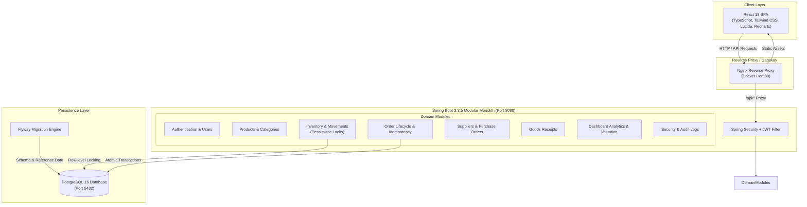
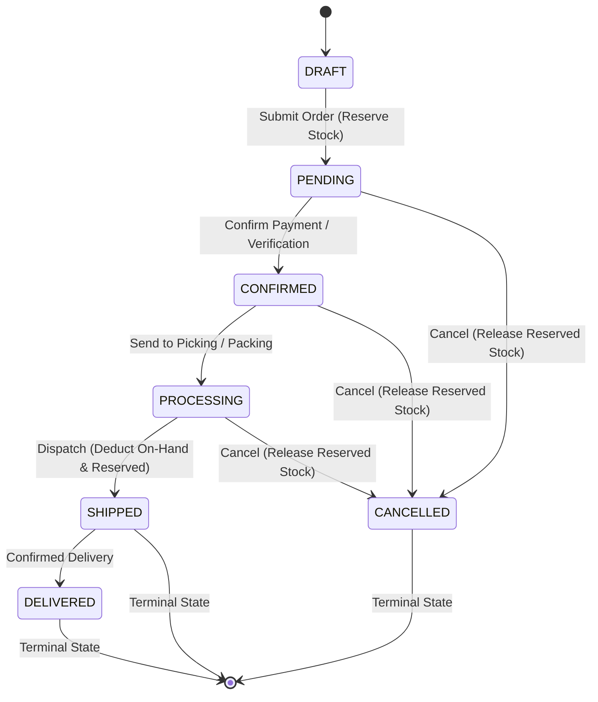
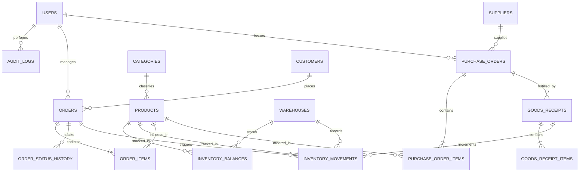

# Smart Inventory & Order Management System

[](https://openjdk.org/)
[](https://spring.io/projects/spring-boot)
[](https://react.dev/)
[](https://www.typescriptlang.org/)
[](https://tailwindcss.com/)
[](https://www.postgresql.org/)
[](https://www.docker.com/)

A production-grade, modular monolith **Smart Inventory & Order Management System** designed for small-to-medium businesses (SMBs). It solves real-world supply chain challenges: inventory discrepancies, race-condition overselling during concurrent checkouts, lack of historical audit trails, supplier delivery tracking, and role-based data security.

---

## 1. Problem Statement & Real-World Solutions

| Real-World Problem | System Solution & Implementation |
|---|---|
| **Unknown available stock** | Strict stock formula: `available = onHand - reserved`. Enforced on every read and write. |
| **Inconsistent stock edits** | Disallow direct stock edits; all mutations go through adjustments, receipts, or order fulfillments. |
| **Overselling race conditions** | Concurrency-safe stock reservations via PostgreSQL pessimistic row locks (`SELECT ... FOR UPDATE`). |
| **Duplicate orders / clicks** | Full request idempotency via unique `idempotencyKey` and dedicated transaction persistence. |
| **Deadlocks on multi-product orders** | Deterministic product sorting by `productId ASC` prior to lock acquisition. |
| **Unnoticed low stock** | Automated threshold calculations (`onHand <= reorderLevel`) with real-time alert APIs and UI. |
| **Untracked supplier deliveries** | Purchase Order lifecycle (`DRAFT` → `APPROVED` → `PARTIALLY_RECEIVED` → `RECEIVED`) with partial receipt tracking and over-receipt rejection. |
| **Missing audit trails** | Append-only, immutable `inventory_movements` table recording actor, delta, timestamp, reference ID, and movement type. |
| **Unauthorized changes** | Role-Based Access Control (`ADMIN`, `INVENTORY_MANAGER`, `SALES_STAFF`, `VIEWER`) enforced on Spring Security method and endpoint levels. |
| **Multi-warehouse imbalances** | Inter-warehouse Stock Transfers (`REQUESTED` → `IN_TRANSIT` → `COMPLETED`) with locked source reservations and in-transit tracking. |
| **Data entry speed & errors** | Interactive Barcode & QR Code scanner (webcam, USB scanner, and test simulation) + Code 128 vector barcode renderer. |
| **Physical dispatch documentation** | One-click printable Commercial Invoices and Warehouse Packing Slips with QA check-off sheets. |
| **Delayed inventory notifications** | Real-time Server-Sent Events (SSE) stream pushing low-stock and order alerts directly to connected browsers. |
| **Accounting & reporting friction** | Server-side and client-side one-click CSV data export for orders, inventory balances, and movements. |
| **Brute-force security risks** | In-memory token bucket rate limiting on authentication login endpoints. |

---

## 2. Architecture Overview

The system is built as a **modular monolith** with clean boundary separation between domain modules:



---

## 3. Concurrency & Inventory Invariant Model

### The Stock Invariant Formula
$$\text{availableQuantity} = \text{onHandQuantity} - \text{reservedQuantity}$$

1. **Physical On-Hand Stock (`onHandQuantity`)**: Actual physical inventory residing on warehouse shelves.
2. **Reserved Stock (`reservedQuantity`)**: Stock earmarked for confirmed/pending orders that have not yet physically shipped.
3. **Available Stock (`availableQuantity`)**: Free stock available for new customer orders.

### Non-Negotiable Database Invariants
- `availableQuantity >= 0` (No overselling under any load).
- `reservedQuantity >= 0`.
- `reservedQuantity <= onHandQuantity`.
- Every stock-changing operation creates an immutable row in `inventory_movements`. Ordinary users cannot update or delete movements.

### Concurrency & Deadlock Prevention Strategy
When an order containing $N$ products is received:
1. Validate client payload and customer status.
2. Check `order_idempotency` table for matching key; if present, return existing order immediately.
3. **Sort all requested line items deterministically by `productId ASC`**.
4. Inside a single `@Transactional` boundary, execute `SELECT ... FOR UPDATE` via `balanceRepository.findByProductIdAndWarehouseIdWithLock(...)`.
5. For each locked balance, check `balance.getAvailableQuantity() >= requestedQuantity`. If even one item lacks stock, throw `InsufficientStockException` — **the transaction rolls back 100% of mutations**.
6. If all items have stock, update `reservedQuantity += requestedQuantity`, create `Order`, create line items, record `ORDER_RESERVED` movement events, and commit.

---

## 4. Order Lifecycle State Machine



---

## 5. Database Entity Relationship Diagram (ERD)



---

## 6. Quickstart: Docker Compose

The easiest way to run the entire stack (PostgreSQL + Spring Boot Backend + React Frontend + Nginx) with a single command:

```bash
docker-compose up --build
```

- **Frontend Application**: [http://localhost](http://localhost) (or port 80)
- **Backend REST API**: [http://localhost:8080/api/v1](http://localhost:8080/api/v1)
- **Interactive Swagger UI**: [http://localhost:8080/swagger-ui.html](http://localhost:8080/swagger-ui.html)
- **Actuator Health Endpoint**: [http://localhost:8080/actuator/health](http://localhost:8080/actuator/health)

---

## 7. Local Development Setup (Without Docker)

### Prerequisites
- **Java 21 or Java 24** installed (`java -version`)
- **Node.js 18+ and npm** installed (`node -v`, `npm -v`)
- Maven wrapper is included (`mvnw` / `mvnw.cmd`)

### Running the Backend
By default, running with the `local` profile uses an in-memory H2 database running in PostgreSQL compatibility mode with complete Flyway migrations and development seed data.

```bash
cd backend
./mvnw clean spring-boot:run
# On Windows:
# mvnw.cmd spring-boot:run
```
The backend starts at `http://localhost:8080`.

### Running the Frontend
```bash
cd frontend
npm install
npm run dev
```
The frontend starts at `http://localhost:5173`.

---

## 8. Development Seed Credentials

When `SEED_DATA=true` (enabled by default in local mode), the system auto-seeds realistic products, suppliers, customers, categories, warehouses, and the following 4 role-based user accounts:

| Username | Password | Role | Permissions |
|---|---|---|---|
| `admin` | `Password@123` | `ADMIN` | Full system access, user administration, configuration, reports, all actions |
| `manager` | `Password@123` | `INVENTORY_MANAGER` | Stock management, adjustments, POs, receiving, low-stock alerts |
| `sales` | `Password@123` | `SALES_STAFF` | Product lookup, create customer orders, order cancellation, customer management |
| `viewer` | `Password@123` | `VIEWER` | Read-only access to products, stock levels, orders, and reports |

*Quick login buttons are available on the frontend login screen for instant role switching.*

---

## 9. Test Suite & Verification Results

The backend includes a comprehensive automated test suite with unit tests, web integration tests, and multi-threaded concurrency tests.

### Running Backend Tests
```bash
cd backend
./mvnw test
# On Windows:
# mvnw.cmd test
```

### Verified Test Results (100% Pass Rate):
```text
[INFO] -------------------------------------------------------
[INFO]  T E S T S
[INFO] -------------------------------------------------------
[INFO] Running com.smartinventory.integration.AuthIntegrationTest
[INFO] Tests run: 5, Failures: 0, Errors: 0, Skipped: 0
[INFO] Running com.smartinventory.integration.GoodsReceiptIntegrationTest
[INFO] Tests run: 2, Failures: 0, Errors: 0, Skipped: 0
[INFO] Running com.smartinventory.integration.InventoryConcurrencyIntegrationTest
[INFO] Tests run: 3, Failures: 0, Errors: 0, Skipped: 0
[INFO] Running com.smartinventory.integration.OrderLifecycleIntegrationTest
[INFO] Tests run: 3, Failures: 0, Errors: 0, Skipped: 0
[INFO] Running com.smartinventory.integration.ProductAndInventoryIntegrationTest
[INFO] Tests run: 3, Failures: 0, Errors: 0, Skipped: 0
[INFO] Running com.smartinventory.unit.GoodsReceiptCalculationTest
[INFO] Tests run: 2, Failures: 0, Errors: 0, Skipped: 0
[INFO] Running com.smartinventory.unit.OrderCalculationTest
[INFO] Tests run: 3, Failures: 0, Errors: 0, Skipped: 0
[INFO] Running com.smartinventory.unit.OrderStatusTransitionTest
[INFO] Tests run: 7, Failures: 0, Errors: 0, Skipped: 0
[INFO] 
[INFO] Results:
[INFO] 
[INFO] Tests run: 28, Failures: 0, Errors: 0, Skipped: 0
[INFO] ------------------------------------------------------------------------
[INFO] BUILD SUCCESS
[INFO] ------------------------------------------------------------------------
```

### Key Concurrency Test Highlights:
- **`testConcurrentOrdersForLastStockUnit`**: 2 simultaneous threads compete for exactly 1 unit of stock. Verified: `successCount=1`, `insufficientStockCount=1`, `finalBalance.availableQuantity=0`, `finalBalance.reservedQuantity=1`, zero unhandled exceptions.
- **`testDeadlockFreeMultiProductConcurrency`**: 4 concurrent threads order multiple items in opposite lock sequences (A-B vs B-A). Verified: deterministic sort orders locks by ID, executing all 4 orders in parallel without database deadlocks.
- **`testRepeatedCancellationProtection`**: An order is cancelled twice. Verified: stock is released only on the first cancellation; repeated calls are safely idempotent with 0 duplicate stock releases.

---

## 10. Repository Structure

```text
.
├── backend/                             # Spring Boot 3.3.5 Application
│   ├── src/main/java/com/smartinventory/
│   │   ├── audit/                       # Audit logging & event listeners
│   │   ├── category/                    # Category management
│   │   ├── common/                      # DTOs, PageResponse, ApiResponse, Exceptions
│   │   ├── config/                      # Web, Security, Swagger, DataInitializer
│   │   ├── customer/                    # Customer CRM entities & endpoints
│   │   ├── dashboard/                   # Aggregated metrics & sales valuation
│   │   ├── goodsreceipt/                # Goods receiving from POs
│   │   ├── inventory/                   # Stock balances, movements & locking
│   │   ├── notification/                # Low stock & system alerts
│   │   ├── order/                       # Order lifecycle, items, status history
│   │   ├── product/                     # Product catalog & pricing
│   │   ├── purchaseorder/               # Supplier purchase orders
│   │   ├── security/                    # JWT token provider, filter & user details
│   │   ├── supplier/                    # Supplier directory
│   │   ├── user/                        # User management & RBAC roles
│   │   └── warehouse/                   # Multi-warehouse management
│   ├── src/main/resources/
│   │   ├── db/migration/                # Flyway V1 (DDL) and V2 (Seed Data)
│   │   ├── application.yml              # Base Spring Boot configuration
│   │   ├── application-local.yml        # In-memory H2 PostgreSQL mode
│   │   └── application-postgres.yml     # Production PostgreSQL configuration
│   ├── src/test/java/                   # Unit & Integration test suites
│   ├── Dockerfile                       # Multi-stage backend build
│   └── pom.xml                          # Maven build descriptors & dependencies
├── frontend/                            # React 18 + Vite + TypeScript Application
│   ├── src/
│   │   ├── components/                  # Reusable UI (Modals, Badges, Header, Sidebar)
│   │   ├── context/                     # AuthContext with token refresh
│   │   ├── pages/                       # Dashboard, Products, Orders, Inventory, etc.
│   │   ├── services/                    # Axios API client with auth interceptors
│   │   ├── types/                       # TypeScript interfaces and DTOs
│   │   ├── App.tsx                      # Route definitions & protected routes
│   │   └── main.tsx                     # React root & TanStack Query client
│   ├── nginx.conf                       # Production SPA reverse proxy
│   ├── Dockerfile                       # Multi-stage frontend build (Node -> Nginx)
│   ├── package.json                     # Frontend dependencies
│   ├── tailwind.config.js               # Tailwind styling configuration
│   └── vite.config.ts                   # Vite bundler configuration
├── docs/                                # Detailed architectural documentation
│   ├── architecture.md                  # System design, module boundaries & patterns
│   ├── database-design.md               # Schema, constraints, indices & migrations
│   ├── api-guide.md                     # REST API reference & Swagger guides
│   ├── testing.md                       # Test strategy & concurrency validation
│   └── deployment.md                    # Docker, cloud hosting & production checklist
├── .github/workflows/ci.yml             # GitHub Actions CI pipeline
├── docker-compose.yml                   # Multi-container orchestration
└── README.md                            # Main project documentation
```

---

## 11. Extended Documentation Links

- [Architecture & Design Decisions](docs/architecture.md)
- [Database Design & Schema](docs/database-design.md)
- [API Guide & Reference](docs/api-guide.md)
- [Testing Strategy & Concurrency Proof](docs/testing.md)
- [Deployment & Production Operations](docs/deployment.md)

---

## 12. License
This project is open-source and distributed under the [MIT License](LICENSE).
