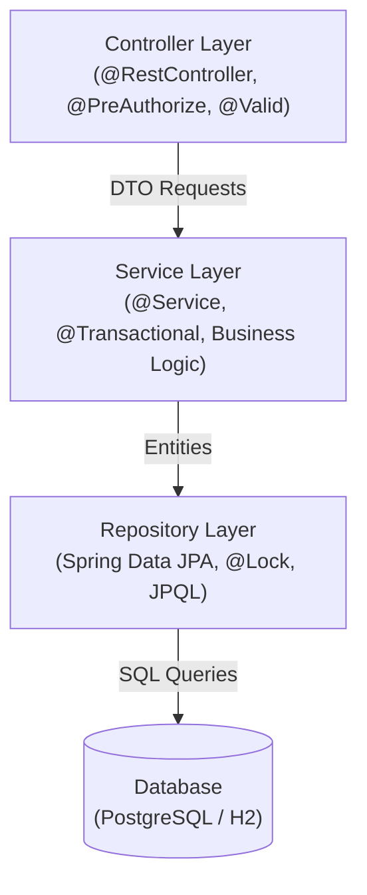

# Architecture Documentation

## 1. Architectural Philosophy & Style

The Smart Inventory & Order Management System is implemented as a **Modular Monolith**.

### Why Modular Monolith?
Small and medium-sized businesses require high transaction consistency, simple operational overhead, and rapid deployment without the complexity of distributed transactions (e.g. Sagas, two-phase commits, Kafka event buses, or Kubernetes orchestration).
By maintaining strict boundary separation inside a single Spring Boot application:
- All inventory mutations and order reservations execute within atomic ACID database transactions.
- Concurrency control utilizes standard PostgreSQL row-level locks without distributed locking services.
- Operational cost is minimal (a single container for the backend and a single PostgreSQL instance).
- If scale necessitates breaking into microservices in the future, domain packages already maintain clean interfaces and DTO boundaries.

---

## 2. Layered Structure

Each domain module in the backend (`com.smartinventory.<module>`) adheres to a standard layered architecture:



1. **Controller Layer**:
   - Handles HTTP protocol concerns, serialization/deserialization.
   - Enforces Role-Based Access Control via `@PreAuthorize`.
   - Triggers Jakarta Bean Validation (`@Valid`).
   - Standardizes responses via generic `ApiResponse<T>` and `PageResponse<T>`.

2. **Service Layer**:
   - Houses transactional business rules and inventory invariants.
   - Manages state machine transitions for orders and purchase orders.
   - Acquires deterministic row locks for concurrency safety.
   - Publishes audit events and generates movement records.

3. **Repository Layer**:
   - Encapsulates queries with Spring Data JPA.
   - Employs explicit pessimistic write locks (`LockModeType.PESSIMISTIC_WRITE`) for inventory balance queries.
   - Provides optimized join fetch queries to prevent $N+1$ query issues.

---

## 3. Concurrency Control Strategy

### The Overselling Problem
When two users concurrently submit orders for the same SKU with only 1 unit remaining, a naive `SELECT stock -> IF stock > 0 -> UPDATE stock` workflow results in a race condition where both orders see 1 available unit, resulting in -1 physical units (overselling).

### Strategy Selected: Pessimistic Row-Level Locking (`PESSIMISTIC_WRITE`)
```java
@Lock(LockModeType.PESSIMISTIC_WRITE)
@Query("SELECT b FROM InventoryBalance b WHERE b.product.id = :productId AND b.warehouse.id = :warehouseId")
Optional<InventoryBalance> findByProductIdAndWarehouseIdWithLock(
        @Param("productId") Long productId,
        @Param("warehouseId") Long warehouseId
);
```

### Why Pessimistic Locking over Optimistic Locking?
- **High Contention Behavior**: In high-demand flash-sales or low-stock scenarios, optimistic locking with `@Version` triggers widespread `OptimisticLockException` and requires complex application-level retry mechanisms. Under heavy contention, most retries will fail anyway if stock is genuinely exhausted.
- **Immediate Serialization**: With `PESSIMISTIC_WRITE` (`SELECT ... FOR UPDATE`), the first transaction to acquire the row lock evaluates the inventory. The second concurrent transaction is blocked at the database level until the first commits. When the second transaction acquires the row, it immediately reads the updated `reservedQuantity` and aborts with `InsufficientStockException` gracefully.

### Deadlock Elimination via Deterministic Lock Ordering
When an order includes multiple distinct products (e.g. Products #5, #12, #3):
If Thread 1 locks #5 then #12, while Thread 2 locks #12 then #5, a database deadlock occurs.
**Solution**: The system deterministically sorts all requested items by `productId ASC`:
```java
List<CreateOrderItemRequest> sortedItems = new ArrayList<>(request.getItems());
sortedItems.sort(Comparator.comparing(CreateOrderItemRequest::getProductId));
```
Every transaction acquires locks in the exact same order across the entire database, mathematically eliminating cyclic wait conditions (deadlocks).

---

## 4. Request Idempotency

Network blips or double button clicks can cause duplicate order submissions.
To guarantee idempotency:
1. Every order creation endpoint optionally accepts an `idempotencyKey` (UUID or client transaction reference).
2. Before acquiring locks or modifying state, the `OrderService` checks:
```java
if (request.getIdempotencyKey() != null) {
    Optional<Order> existing = orderRepository.findByIdempotencyKey(request.getIdempotencyKey());
    if (existing.isPresent()) {
        log.info("Idempotent request detected for key: {}", request.getIdempotencyKey());
        return mapToDTO(existing.get());
    }
}
```
3. If an order with that key already exists, the service bypasses inventory reservation and returns the previously generated order DTO directly.

---

## 5. Security & RBAC Architecture

Security is enforced through stateless JSON Web Tokens (JWT):
- The `JwtAuthenticationFilter` intercepts incoming HTTP requests, extracts the `Authorization: Bearer <token>` header, verifies the cryptographic signature (HMAC-SHA256), and populates Spring's `SecurityContextHolder`.
- Authorization is declared declaratively at both the security filter chain level and via method-level `@PreAuthorize("hasRole('ADMIN') or hasRole('INVENTORY_MANAGER')")`.
- Frontend role-based rendering is purely a user experience convenience; all privileges are strictly validated on the backend.
